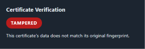
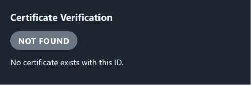

# Certificate Verifier

An API for issuing certificates and verifying them publicly, with SHA-256 tamper detection.

## Why this exists

Certificates are easy to edit or fake, and an employer has no quick way to check one. This project lets an institution issue certificates and lets anyone verify them through a public link or QR code, with no login needed.

## What it does

- Issuers register and log in (passwords are hashed, logins use JWT tokens).
- An issuer creates a certificate. The server stores it with a unique public ID and a SHA-256 fingerprint of its details.
- Anyone can open the verification link and see one of four results: **valid**, **revoked**, **tampered** or **not found**.
- If a certificate's stored data is edited after issuing, the fingerprint no longer matches and verification reports it as tampered.
- Issuers can list only their own certificates, and revoke only their own.
- Every certificate has a QR code that points to its verification page.

## How verification works

1. When a certificate is issued, the server creates a random public ID and computes a SHA-256 fingerprint from the ID, holder name, course name and issue date.
2. The fingerprint is stored with the certificate.
3. When someone verifies a certificate, the server recomputes the fingerprint from the stored data and compares it with the saved one.
4. If they match, the result is **valid** (or **revoked**, if the issuer cancelled it). If they differ, the data was changed after issuing, and the result is **tampered**.

The data is written in a fixed JSON form before hashing, so two different certificates can never produce the same text.

## Results

| Valid | Revoked |
|---|---|
|  |  |

| Tampered | Not found |
|---|---|
|  |  |

A tampered result deliberately shows no holder, course or date, because the edited data can't be trusted.
